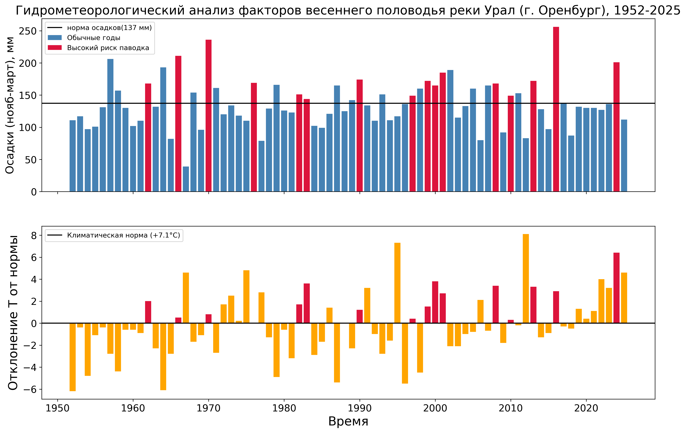

Учебный проект по программированию (Факультет географии и геоинформационных технологий НИУ ВШЭ, группа БГЕО251).

## Описание проекта
Река Урал имеет восточноевропейский тип водного режима с преобладанием снегового питания, в связи с чем до 80% годового стока приходится на период весеннего половодья. В отдельные годы экстремальный подъем уровня воды приводил к масштабным наводнениям (включая исторический паводок 2024 года).

В данном проекте на основе многолетних рядов метеостанции **Оренбург (35121)** за **1952–2025 гг.** реализован комплексный анализ главных предвестников паводковой опасности.

## Задачи проекта
1. Загрузка и программная очистка многолетних метеорологических рядов (температуры и осадков) с помощью разработанного модуля.
2. Расчет осадков холодного периода (ноябрь–март) как показателя зимнего снегонакопления.
3. Выделение лет с повышенным паводковым риском с использованием булевых масок `numpy` (одновременное превышение нормы зимних осадков и нормы температуры апреля).
4. Визуализация результатов в виде сопряженной двухпанельной диаграммы с сохранением графиков в репозиторий.

## Результаты анализа
С помощью программной фильтрации за период 1952–2025 гг. было выделено **16 лет** (`1962, 1966, 1970, 1976, 1982, 1983, 1990, 1997, 1999, 2000, 2001, 2008, 2010, 2013, 2016, 2024`), в которые экстремальное снегонакопление сочеталось с аномально теплой весной. Полученные данные полностью согласуются с реальными историческими наблюдениями (включая экстремальный паводок 2024 года).

Ниже представлена построенная диаграмма факторов половодья:

## Структура репозитория
* `data/` — папка с исходными таблицами данных (`orenburg_temp.csv`, `orenburg_precip.csv`).
* `figures/` — папка с сохраненными графиками исследования (`orenburg_flood_analysis.png`).
* `project_tools.py` — пользовательский модуль с функциями очистки данных, расчета зимних осадков и фильтрации рисков.
* `project_research.ipynb` — Jupyter-тетрадь с полным циклом анализа, расчетами и выводами.

## Список авторов
* **Ледяев Роман Олегович** (Группа БГЕО251, ФГГТ НИУ ВШЭ)
